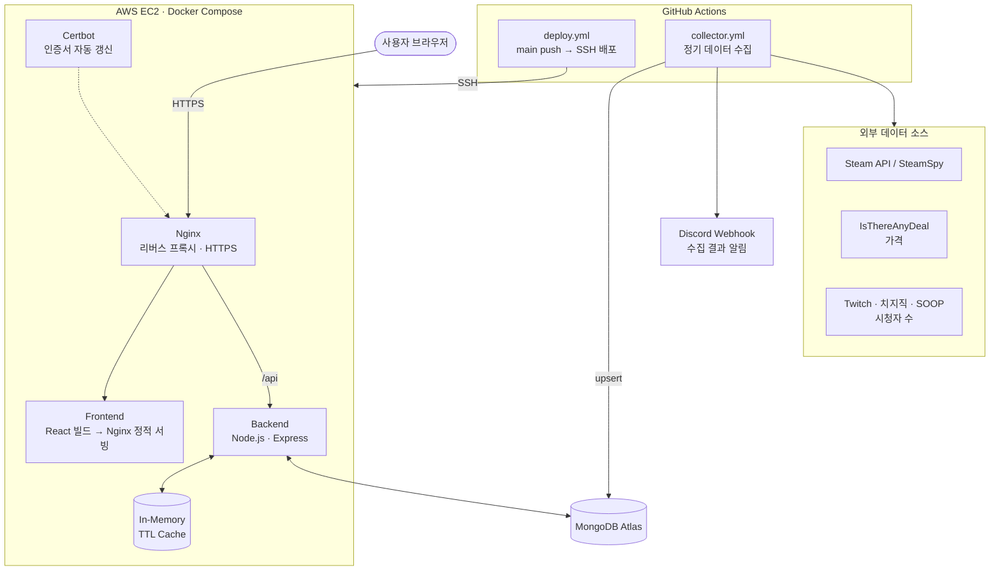
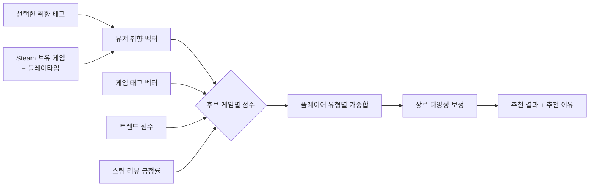
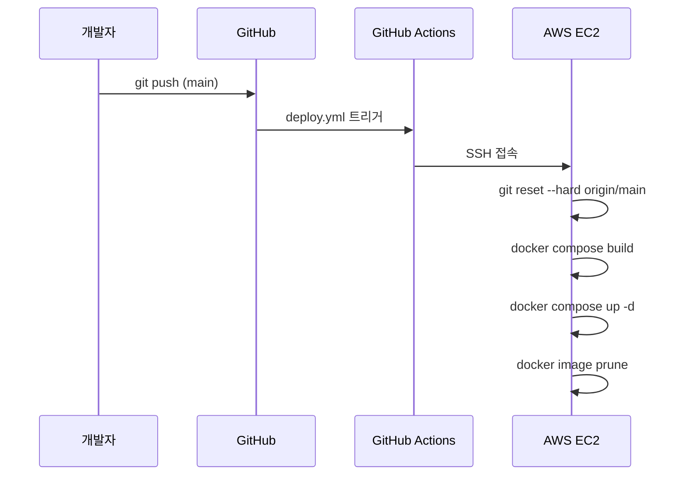

# 🎮 AuraProject — 플레이 성향 기반 게임 추천 서비스

> **"지금 뭐 하지?"에 답하는 서비스.**
> Steam 플레이 기록과 취향 태그, 그리고 Twitch·치지직·SOOP 실시간 시청자 트렌드를 결합해 개인 맞춤 게임을 추천합니다.

🔗 **Live**: https://playforyou.net  
📄 **API Docs**: `https://playforyou.net/api-docs` (Swagger) · [API 명세](docs/API.md) · [DB 명세](docs/DATABASE.md)  
🎓 대학교 졸업작품 발표 프로젝트 · 3인 팀 · **팀장 김주한 (풀스택 · 인프라)**

<!-- TODO: 메인 화면 / 개인 추천 화면 / 게임 상세(가격·트렌드 차트) 스크린샷 3장 추가 -->
<!--  -->

---

## 👥 팀 구성 및 역할

| 이름 | 역할 | 담당 업무 |
|---|---|---|
| **김주한** | **팀장 · 풀스택** | 서비스 기획 · 추천 알고리즘 설계·구현 · 백엔드 API · DB 설계 · 외부 API 키 발급 및 연동 (Steam, ITAD, Twitch, 치지직, SOOP, Google, Naver) · 데이터 수집 파이프라인 · 프론트엔드 · 팀원 화면 통합 및 인증·DB 연결 · Docker / AWS EC2 배포 · CI/CD · 버그 추적 및 해결 |
| 조영진 | 프론트엔드 | 화면 UI 개발 참여 |
| 이재우 | 백엔드 · 알고리즘 | 화면 UI 개발 참여 |

> 팀원이 개발한 로그인 페이지와 고객지원(문의) 게시판 화면을 받아 백엔드 인증·DB와 연결했고, 그 외 전 영역을 직접 설계·구현해 하나의 운영 서비스로 통합했습니다.

---

## 📌 목차
1. [문제 정의](#-문제-정의)
2. [핵심 기능](#-핵심-기능)
3. [시스템 아키텍처](#-시스템-아키텍처)
4. [기술 스택](#-기술-스택)
5. [추천 알고리즘](#-추천-알고리즘)
6. [데이터 파이프라인](#-데이터-파이프라인)
7. [배포 및 운영](#-배포-및-운영)
8. [트러블슈팅](#-트러블슈팅)
9. [회고 및 개선 계획](#-회고-및-개선-계획)
10. [로컬 실행 방법](#-로컬-실행-방법)

---

## 🎯 문제 정의

| 문제 | 기존 서비스의 한계 | AuraProject의 접근 |
|---|---|---|
| 게임이 너무 많아 고르기 어렵다 | 스토어는 판매량 순 노출 위주 | **플레이 기록 + 선택 태그** 기반 개인화 |
| 한 장르만 계속 추천된다 | 많이 한 장르일수록 더 추천 (필터 버블) | **포화 태그 감쇠**로 새로운 장르 발견 유도 |
| "요즘 뜨는 게임"을 알기 어렵다 | 국내 방송 플랫폼 트렌드 미반영 | **Twitch + 치지직 + SOOP** 시청자 수를 트렌드 점수에 반영 |
| 가격·할인 정보가 흩어져 있다 | 스토어별로 직접 확인 필요 | 여러 스토어 가격 비교 + **할인 알림** |

---

## ✨ 핵심 기능

- **개인 맞춤 추천**: Steam 계정 연동 → 보유 게임·플레이타임 분석 → 취향 벡터 생성 → 미보유 게임을 **종합 · 가성비 · 트렌드 · 숨겨진 명작 · 멀티플레이** 5개 섹션으로 추천 (추천 이유 문구 포함)
- **플레이어 유형별 가중치**: 캐주얼 / 입문 / 중수 / 하드코어 / 스트리머 5가지 유형에 따라 리뷰·태그·트렌드·플레이 이력 가중치를 다르게 적용
- **트렌드 랭킹**: 스팀 동시접속자 + 방송 플랫폼 시청자 수 기반 인기·급상승 정렬
- **가격 비교 & 알림**: 스토어별 최저가, 역대 최저가, 찜한 게임 할인 시 알림
- **PC 사양 체크**: 내 CPU/GPU로 게임 최소 사양 충족 여부 확인
- **회원 기능**: 자체 회원가입(이메일 OTP 인증) + Google · Naver · Steam 소셜 로그인
- **고객지원**: FAQ, 1:1 문의, 관리자 답변 페이지

---

## 🏗 시스템 아키텍처



### 설계 포인트
- **수집과 서비스의 분리**: 무거운 크롤링(Puppeteer 포함)은 GitHub Actions 러너에서 실행해 EC2 서버의 메모리와 CPU를 서비스 응답에만 쓰도록 분리
- **작은 인스턴스에 맞춘 튜닝**: Node 힙 512MB 제한, 프론트엔드 멀티스테이지 빌드로 런타임 이미지에서 Node 제거, 외부 의존성 없는 인메모리 TTL 캐시
- **장애 대비**: Docker healthcheck(`/health`), `restart: always`, Graceful shutdown(SIGTERM 시 진행 중 요청 처리 후 DB 연결 종료), 필수 환경변수 누락 시 기동 거부

---

## 🛠 기술 스택

| 영역 | 기술 |
|---|---|
| Frontend | React 19, React Router 7, Recharts, styled-components |
| Backend | Node.js 20, Express 4, Mongoose 8, Passport (Local · JWT · Google · Naver · Steam) |
| Database | MongoDB Atlas (세션 저장소 connect-mongo 포함) |
| Data Collection | Axios, Cheerio, Puppeteer, Steam / ITAD / Twitch / 치지직 / SOOP API |
| Infra | AWS EC2, Docker, Docker Compose, Nginx, Let's Encrypt (Certbot) |
| CI/CD · Pipeline | GitHub Actions (배포, 스케줄 기반 데이터 수집) |
| 보안 | Helmet, express-rate-limit, bcrypt, JWT, HttpOnly 세션 쿠키, DOMPurify |
| 모니터링·알림 | Discord Webhook, 파일 로거, DB health check 스크립트 |

---

## 🧠 추천 알고리즘

태그 기반 **콘텐츠 기반 필터링**에 트렌드와 품질 신호를 결합한 하이브리드 스코어링입니다.



**1. 유저 취향 벡터** (`backend/utils/vector.js`)
- 직접 선택한 태그: 강한 신호로 높은 가중치
- Steam 플레이타임: `log10(플레이타임)`으로 반영해 수천 시간 플레이한 게임 하나가 벡터를 지배하지 않도록 완화
- **포화 태그 감쇠**: 특정 태그가 전체 플레이의 30% / 50% 이상이면 가중치 상한 적용
  → 배틀그라운드를 2,000시간 한 유저에게 FPS만 추천되는 필터 버블 방지

**2. 유사도**: 유저 벡터와 게임 태그 벡터의 코사인 유사도 (태그를 과도하게 단 게임은 페널티)

**3. 플레이어 유형별 가중치** (`backend/controllers/recommendController.js`)

| 유형 | 리뷰 | 태그 | 트렌드 | 플레이 이력 | 특징 |
|---|---|---|---|---|---|
| 캐주얼 | **0.45** | 0.35 | 0.10 | 0.10 | 고난이도 게임 감점 |
| 입문 | 0.35 | **0.40** | 0.15 | 0.10 | |
| 중수 | 0.25 | 0.35 | 0.20 | 0.20 | |
| 하드코어 | 0.15 | 0.35 | 0.15 | **0.35** | 고난이도 가점 |
| 스트리머 | 0.20 | 0.25 | **0.40** | 0.15 | 멀티플레이 가점 |

**4. 다양성 보정**: 유사 장르를 버킷으로 묶어 상위 결과에 한 버킷이 최대 3개까지만 오도록 재배치

**5. 설명 가능성**: "RPG, 오픈월드 장르 취향에 맞는 게임 · 50% 할인 중"처럼 추천 이유를 함께 표시

---

## 🔄 데이터 파이프라인

GitHub Actions 스케줄로 실행되며, 결과는 Discord로 알림을 받습니다.

| 작업 | 주기 (KST) | 내용 |
|---|---|---|
| 트렌드 수집 | 매일 19:00 | 스팀 동시접속자 + Twitch · 치지직 · SOOP 시청자 수 → `trend_score`, 시계열은 `TrendHistory`에 저장 |
| 신규 게임 · 가격 | 매일 03:00 | 인기·신작 게임 신규 등록 (일 최대 30개), 3일 이상 지난 가격 갱신, 메타데이터 보완 |
| 주간 전수 갱신 | 매주 월 02:00 | 전체 게임 스팀 리뷰 긍정률 재계산 |
| 수동 작업 | `workflow_dispatch` | 태그 재매핑, 난이도·메타데이터 재계산, 전체 실행 |

- **트렌드 점수**: `Twitch 시청자 + (치지직 + SOOP 시청자) × 2 + 스팀 동접자 × 0.3` — 한국 사용자 대상 서비스라 국내 방송 플랫폼에 2배 가중치
- **태그 정규화**: Steam 원본 태그를 한국어 `smart_tags` 체계로 매핑 (`backend/utils/tagMapper.js`)
- **외부 API 실패 대응**: 플랫폼별 연속 실패 카운트, 요청 간 딜레이, 실패해도 다음 단계는 계속 진행

---

## 🚀 배포 및 운영



| 항목 | 구현 |
|---|---|
| 배포 | `main` 푸시 시 자동 배포 (`.github/workflows/deploy.yml` → `deploy.sh`) |
| HTTPS | Nginx + Certbot, 12시간마다 인증서 갱신 확인 |
| 헬스체크 | `GET /health` (DB 연결 상태 포함), Docker healthcheck 30초 주기 |
| 백업 | 매일 DB 백업 스크립트 실행 |
| 비밀 관리 | `.env`는 Git 제외, CI에서는 GitHub Secrets 사용 |
| 트래픽 보호 | API 전체 / 추천 / 로그인 엔드포인트별 Rate Limit |

---

## 🔥 트러블슈팅

<!-- 아래는 코드에서 확인되는 문제들입니다. 실제로 겪은 상황, 원인, 수치를 채워 넣으세요. 면접에서 가장 많이 묻는 부분입니다. -->

### 1. 태그를 여러 개 선택할수록 결과가 사라지는 문제
- **현상**: 태그를 AND 조건으로 검색해 3~4개만 선택해도 결과가 0개가 됨
- **해결**: 메인 목록은 OR(`$in`)로 후보를 넓힌 뒤, 일치 태그 수(`matchCount`)로 정렬해 "많이 맞는 게임이 위로" 오도록 변경

### 2. 작은 EC2에서 크롤링과 서비스가 메모리를 두고 경쟁하는 문제
- **현상**: Puppeteer 기반 수집이 돌 때 API 응답이 느려지거나 컨테이너가 재시작됨 <!-- TODO: 실제 증상 확인 -->
- **해결**: 무거운 수집 작업을 GitHub Actions 러너로 이전, 서버 내 작업은 `child_process`로 분리해 메모리 격리, Node 힙 상한 설정

### 3. 외부 데이터 이상치 (비정상 가격, 잘못 매칭된 게임)
- **현상**: 수십만 원짜리 가격, 게임이 아닌 앱이 섞여 들어옴
- **해결**: 정상 가격 범위 필터, 성인·비게임 콘텐츠 정리, DB health check 스크립트로 수집 전후 데이터 품질 측정

### 4. 한 장르만 반복 추천되는 필터 버블
- **해결**: 포화 태그 가중치 상한 + 장르 버킷 다양성 보정 (위 알고리즘 참고)

---

## 💭 회고 및 개선 계획

팀장으로서 기획부터 배포까지 완주하면서, 기능을 빠르게 붙이는 데 집중하느라 **테스트 자동화와 관측성**은 뒤로 미뤘습니다. 이후 개선 방향은 다음과 같습니다.

| 현재 | 개선 방향 |
|---|---|
| 추천 API가 요청 본문의 `userId`를 신뢰 | 세션의 사용자 ID만 사용하도록 변경 (타인 ID로 추천 결과 조회 차단) |
| 일회성 데이터 보정 스크립트 다수 | 검증 로직을 수집 단계로 흡수, 스키마 검증 도입 |
| 수동 확인 위주의 테스트 | Jest + Supertest로 추천 API 단위·통합 테스트, CI에서 자동 실행 |
| 배포 전 테스트 단계 없음 | `test → build → deploy` 단계 분리, 이미지 레지스트리(ECR) 기반 배포 |
| 단일 인스턴스 인메모리 캐시 | Redis 도입으로 재시작 시 캐시 유지, 수평 확장 대비 |
| Discord 알림 위주의 모니터링 | Prometheus + Grafana로 응답시간·에러율·수집 성공률 대시보드 |
| 태그 기반 콘텐츠 필터링 | 찜·투표 데이터가 쌓이면 협업 필터링을 섞은 하이브리드 추천 |

---

## 💻 로컬 실행 방법

### 사전 준비
- Docker, Docker Compose
- MongoDB 연결 URI (Atlas 무료 티어 가능)

### 1. 환경 변수 설정
```bash
cp backend/.env.example backend/.env
# MONGODB_URI, SESSION_SECRET, JWT_SECRET 은 필수
```

<details>
<summary>환경 변수 목록</summary>

| 변수 | 필수 | 설명 |
|---|---|---|
| `MONGODB_URI` | ✅ | MongoDB 연결 문자열 |
| `SESSION_SECRET` | ✅ | 세션 서명 키 |
| `JWT_SECRET` | ✅ | JWT 서명 키 |
| `FRONTEND_URL`, `BACKEND_URL` | | 기본값 운영 도메인 |
| `STEAM_API_KEY` | | Steam 로그인·보유 게임 연동 |
| `GOOGLE_CLIENT_ID`, `GOOGLE_CLIENT_SECRET` | | Google 로그인 |
| `NAVER_CLIENT_ID`, `NAVER_CLIENT_SECRET` | | Naver 로그인 |
| `ITAD_API_KEY` | | 가격 수집 |
| `TWITCH_CLIENT_ID`, `TWITCH_CLIENT_SECRET` | | Twitch 시청자 수 |
| `SOOP_CLIENT_ID`, `SOOP_CLIENT_SECRET` | | SOOP 시청자 수 |
| `DISCORD_WEBHOOK_URL` | | 수집 결과 알림 |

</details>

### 2. 실행
```bash
docker compose up -d --build
```

### 3. 데이터 수집 (최초 1회)
```bash
docker exec -d my-backend sh scripts/run_all.sh
docker exec my-backend tail -f /tmp/run_all.log
```

---

## 📁 프로젝트 구조

```
AuraProject/
├── .github/workflows/
│   ├── deploy.yml          # main push → EC2 자동 배포
│   └── collector.yml       # 스케줄 기반 데이터 수집 파이프라인
├── backend/
│   ├── controllers/        # 추천 · 인증 · 투표
│   ├── routes/             # REST API 라우팅
│   ├── models/             # Game, User, TrendHistory, PriceHistory 등
│   ├── middleware/         # JWT 인증, 에러 핸들러
│   ├── utils/              # 벡터 연산, 태그 매핑, 캐시, 로거
│   ├── scripts/            # 데이터 수집 · 보정 · 백업
│   └── config/swagger.js   # API 문서
├── frontend/
│   └── src/                # 페이지, 컴포넌트, PC 사양 비교 데이터
├── docs/
│   ├── API.md              # API 명세
│   └── DATABASE.md         # DB(컬렉션) 명세
├── docker-compose.yml      # nginx · certbot · frontend · backend
└── deploy.sh
```
