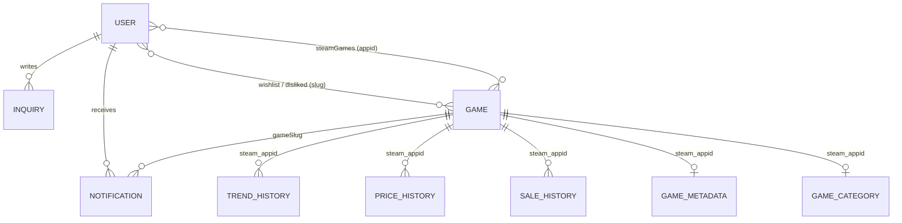

# DB 명세

> MongoDB Atlas · ODM: Mongoose · 정의 위치: `backend/models/`

## 설계 방향

| 원칙 | 적용 |
|---|---|
| **읽기 중심 구조** | 게임 목록과 추천 조회가 대부분이라, 게임 한 건에 가격·리뷰·트렌드 현재값을 **임베딩**해 한 번의 조회로 화면을 그림 |
| **현재값과 이력 분리** | 최신 값은 `games`에, 시간에 따라 쌓이는 값은 `trend_history` · `price_history` · `sale_history`에 따로 저장 → 게임 문서가 무한히 커지지 않음 |
| **수집 설정 분리** | 외부 API 매칭 정보(ITAD ID, 트위치 카테고리 등)는 `gamemetadatas` · `gamecategories`에 두어, 수집기 로직과 서비스 데이터를 분리 |
| **데이터 정합성은 모델에서 보장** | 무료 게임이거나 현재가 0원이면 할인율을 0으로 강제하는 저장 전 미들웨어 |

## 컬렉션 관계

> MongoDB라 외래 키 제약은 없습니다. `steam_appid`와 `slug`를 연결 키로 사용합니다.

---

## 1. `games` — 게임 (핵심 컬렉션)

| 필드 | 타입 | 설명 |
|---|---|---|
| `slug` | String · unique | URL 식별자 |
| `steam_appid` | Number | Steam 앱 ID (타 플랫폼 게임은 없을 수 있음) |
| `platforms` | [String] | 기본 `['Steam']` |
| `title`, `title_ko` | String | 영문 · 한글 제목 |
| `main_image`, `screenshots`, `trailers` | String / [String] | 미디어 |
| `isAdult` | Boolean | 성인 게임 여부 (모든 조회에서 제외) |
| `tags` | [String] | Steam 원본 태그 |
| `smart_tags` | [String] | 원본 태그를 한국어 체계로 정규화한 태그. **추천의 기준** |
| `difficulty` | String | `초심자` · `보통` · `심화` · `정보 없음` |
| `trend_score` | Number | `Twitch 시청자 + (치지직 + SOOP 시청자) × 2 + 스팀 동접자 × 0.3` — 국내 방송 플랫폼에 2배 가중치 |
| `steam_ccu` | Number | 스팀 동시접속자 |
| `twitch_viewers`, `chzzk_viewers`, `soop_viewers` | Number | 방송 플랫폼별 시청자 수 |
| `steam_reviews.overall / recent` | Object | `summary`, `positive`, `total`, `percent` |
| `metacritic_score`, `igdb_score` | Number | 외부 평점 |
| `price_info` | Object | `regular_price`, `current_price`, `discount_percent`, `historical_low`, `isFree`, `expiry`, `store_url`, `deals[]`(스토어별 가격) |
| `play_time` | Object | `main`, `extra`, `completionist` (시간) |
| `pc_requirements` | Object | `minimum`, `recommended` |
| `releaseDate` | Date | 출시일 |
| `votes[]`, `likes_count`, `dislikes_count` | | 사용자 좋아요/싫어요 |

**인덱스** (메인 목록이 항상 `isAdult` 필터 + 정렬 조합으로 조회되는 패턴에 맞춤)

| 인덱스 | 용도 |
|---|---|
| `{ isAdult, trend_score: -1 }` | 인기순 |
| `{ isAdult, steam_ccu: -1 }` | 동접자순 |
| `{ isAdult, price_info.discount_percent: -1 }` | 할인순 |
| `{ isAdult, price_info.current_price: 1 }` | 가격순 |
| `{ isAdult, releaseDate: -1 }` | 신작순 |
| `{ isAdult, steam_reviews.overall.percent: -1 }` | 평점순 |
| `{ isAdult, smart_tags, steam_ccu: -1 }` | 태그 필터 + 정렬 |
| `title`, `title_ko`, `smart_tags`, `difficulty`, `platforms` | 단일 인덱스 |

---

## 2. `users` — 사용자

| 필드 | 타입 | 설명 |
|---|---|---|
| `username` | String · unique | 로그인 ID (소셜 가입은 `google_{id}` 형식 자동 생성) |
| `email` | String · unique | |
| `password` | String | bcrypt 해시 (소셜 전용 계정은 없음) |
| `displayName`, `avatar` | String | 표시 이름, 프로필 이미지 |
| `role` | String | `user` · `admin` |
| `playerType` | String | `casual` · `beginner` · `intermediate` · `hardcore` · `streamer` (추천 가중치 결정) |
| `playerTypeSetByUser` | Boolean | 온보딩 완료 여부 |
| `googleId`, `naverId`, `steamId` | String | 소셜 계정 연동 ID |
| `steamGames[]` | Array | `appid`, `name`, `playtime_forever`(분), `smart_tags` — Steam 연동 시 동기화 |
| `likedTags` | [String] | 직접 선택한 취향 태그 |
| `tagWeights` | Map<String, Number> | 태그별 가중치 (-1.0 ~ 2.0) |
| `wishlist`, `dislikedGames` | [String] | 찜 / 관심없음 게임 slug |
| `priceAlerts[]` | Array | `slug`, `targetPrice`, `createdAt` |
| `notificationSettings` | Object | `saleAlert`, `newGameAlert`, `emailAlert` |
| `passwordResetTokenHash`, `passwordResetTokenExpiresAt` | | 비밀번호 재설정 토큰 (해시로만 저장) |
| `createdAt`, `updatedAt` | Date | 자동 기록 |

---

## 3. 시계열 · 이력

### `trend_history` — 트렌드 이력
| 필드 | 설명 |
|---|---|
| `steam_appid` (index) | 게임 |
| `trend_score`, `steam_ccu`, `twitch_viewers`, `chzzk_viewers`, `soop_viewers` | 수집 시점 값 |
| `recordedAt` (index) | 수집 시각 |

게임 상세의 14일 트렌드 차트, 메인의 "급상승"(최근 3일 상승폭) 정렬에 사용

### `price_history` — 가격 이력
`steam_appid`, `regular_price`, `current_price`, `discount_percent`, `isFree`, `historical_low`, `recordedAt`

### `sale_history` — 할인 이력
`steam_appid`, `current_price`, `regular_price`, `discount_percent`, `store_name`, `store_url`, `startDate`, `expiry`, `itad_deals[]`

---

## 4. 수집 설정

### `gamemetadatas` — 외부 API 매칭 정보
| 필드 | 설명 |
|---|---|
| `steamAppId` (unique) | 게임 |
| `aliasAppIds` | 같은 게임의 다른 Steam ID |
| `itad` | `uuid`, `slug`, `manualOverride` — 매번 조회하지 않도록 ITAD ID 캐시 |
| `trend` | `twitchId`, `chzzkKeyword`, `lastChecked` |
| `steam` | `usePackageId`(단품 가격이 없을 때 대체할 패키지), `isFree`(무료 강제 지정) |

### `gamecategories` — 방송 플랫폼 카테고리 매핑
`steamAppId`(unique), `twitch { id, name, boxArt }`, `chzzk { categoryValue, posterImageUrl }`

---

## 5. 회원 · 고객지원

### `otps` — 이메일 인증번호
| 필드 | 설명 |
|---|---|
| `email`, `purpose` | `purpose`: `signup` · `find-username` · `reset-password`. 두 필드 조합 unique |
| `code` | 6자리 |
| `expiresAt` | **TTL 인덱스**로 만료 시 MongoDB가 자동 삭제 (10분) |

### `notifications` — 알림
`userId`(→ users), `type`(`SALE` · `INFO` · `SYSTEM`), `title`, `message`, `gameSlug`, `discountPercent`, `isRead`, `createdAt`

### `inquiries` — 1:1 문의
`userId`(→ users), `category`(`account` · `recommend` · `steam` · `bug` · `etc`), `title`(≤100자), `content`(≤5000자), `status`(`open` · `answered` · `closed`), `answer`, `createdAt`

### `faqs` — FAQ
`category`, `question`, `answer`, `order`, `isActive`

### `sessions` — 로그인 세션
`connect-mongo`가 관리. TTL 1일
